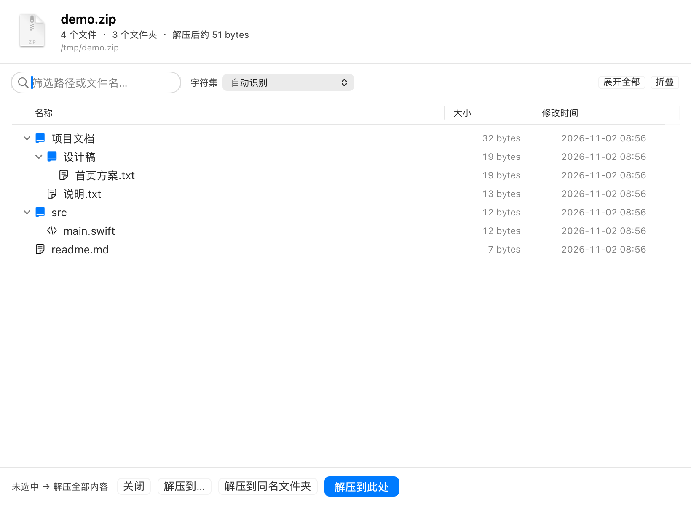

# 压缩包预览器 · ArchivePreview

一个 macOS 原生压缩包预览工具。**双击压缩包只查看内容，不会自动解压**，由你决定要不要解。

A lightweight, native macOS archive viewer written in Swift + AppKit — peek inside `.zip` / `.7z` / `.rar` before extracting, with proper CJK filename decoding.



## 它解决什么问题

macOS 自带的「归档实用工具」只要双击就开始解压，不管你只是想看看里面有什么。第三方工具要么收费、要么为了预览 rar/7z 捆一堆二进制。

这个小工具做三件事：

1. **双击先看，不自动解压**——看清内容再由你决定
2. **按目录层级展示**——不是糊出一堆带路径的平铺文件名
3. **能换字符集**——从中国大陆 / 中国台湾地区 / 日本 / 韩国 Windows 发来的包不再乱码

## 功能

| 功能 | 说明 |
|---|---|
| 树形目录 | 文件夹可展开/折叠，默认全部折叠，只显示顶层；工具栏有「展开全部」「折叠」 |
| 字符集切换 | 自动识别 / UTF-8 / GB18030-GBK / Big5 / Shift-JIS / EUC-KR / Latin-1，切换时保留展开状态 |
| 解压同编码 | 解出后的文件名和列表里看到的一致，不会「预览正常、解压乱码」 |
| 选择性解压 | 解压选中项 / 解压全部 / 解压到同名文件夹 |
| 搜索过滤 | 按路径或文件名筛选，命中时自动展开所有层级 |
| 大小与时间 | 每项显示大小、修改时间（统一为 `2026-11-01 22:54` 格式） |
| 自动清垃圾 | 自动跳过 `__MACOSX`、`.DS_Store`；解压到 ExFAT 等非 APFS 卷时也不留 `._xxx` 影子文件 |
| 接管双击 | 可设为 8 种归档格式的默认打开方式，随时一键还原 |

## 支持的格式

`zip` `tar` `tgz` `gz` `bz2` `xz` `rar` `7z`

以及同类变体：`ipa` `jar` `whl` `apk` `zipx` `xpi` `crx` `cbr` `cb7` `tar.gz`

## 系统要求

- macOS 13 或更新（在 macOS 27 / M4 Mac mini 上开发测试）
- Apple Silicon 或 Intel 均可
- 不需要 Xcode.app，只需要 Command Line Tools（`xcode-select --install`）
- **无第三方依赖**：rar / 7z 读取用的是系统自带的 libarchive（`/usr/bin/tar` 即 bsdtar）

## 安装

```zsh
git clone https://github.com/HarmonyHI/ArchivePreview.git
cd ArchivePreview
./install.sh
```

脚本会：编译 → 组装 `/Applications/压缩包预览器.app` → 本地临时签名 → 重新登记 LaunchServices → 把 8 种归档格式的默认打开方式指过去。

也可以手动编译：

```zsh
swiftc -O -o /tmp/ArchivePreview main.swift
mkdir -p "/Applications/压缩包预览器.app/Contents/MacOS"
cp /tmp/ArchivePreview "/Applications/压缩包预览器.app/Contents/MacOS/压缩包预览器"
cp Info.plist "/Applications/压缩包预览器.app/Contents/Info.plist"
codesign --force --deep --sign - "/Applications/压缩包预览器.app"
```

## 还原默认打开方式

```zsh
swiftc -O -o /tmp/SetHandler SetHandler/main.swift
/tmp/SetHandler revert
killall lsd
```

或者直接删掉 App，然后在任意压缩包上「显示简介 → 打开方式 → 改回归档实用工具」。

## 乱码了怎么办

顶部「字符集」下拉，选 **GB18030 / GBK**。这是从中国大陆 Windows 打包的压缩包最常见的情况（文件名是 GBK 字节，但 ZIP 头里没标 UTF-8）。

其他地区依次试：中国台湾地区 / 中国香港地区 → Big5，日本 → Shift-JIS，韩国 → EUC-KR。

## 实现说明

单文件 `main.swift`（约 1300 行），纯 AppKit 手写 UI，没有 storyboard、没有 SwiftUI、没有第三方库。

**ZIP 自己解析**
不用 `unzip -l`，而是自己读 EOCD → 中央目录 → 取原始文件名字节。只有拿到**原始字节**，字符集切换才有意义（解码成 String 之后原始信息就丢了）。同时处理了 ZIP64 和通用标志位 bit 11（UTF-8 标记）。

**rar / 7z 走系统 libarchive**
macOS 的 `/usr/bin/tar` 就是 bsdtar（libarchive 3.7.4），内置 7z 和 rar 读取。列表解析 `tar -tvf` 的字节流（同样保留原始名字节），解压用 `tar -xf`。

**解压必须用和列表相同的编码**
这是 v1.1.2 之前最严重的一个 bug：列表里中文名显示正常，点解压却报
`checkdir error: cannot create ... Invalid argument`。

原因是预览自己解码（GBK 认对了），解压却交给 `/usr/bin/unzip`——它按 CP437
解释没有 UTF-8 标志位的文件名，GBK 字节被解成问号和非法字节，`mkdir` 直接 EINVAL。

修法是解压也改为走 libarchive，并把当前生效的编码通过
`--options hdrcharset=GB18030` 传过去。为此新增 `detectEncoding()` 把「自动识别」
落成一个具体编码（UTF-8 逐条验证不过就按 GB18030），列表和解压共用同一个结果，
保证两边永远一致。

注意不能靠「哪种编码成功率最高」来猜：GBK 的字节在 EUC-KR / Big5 下同样是合法
双字节组合，成功率都是 100%，实测纯 GBK 中文包会被误判成 EUC-KR 解出满屏韩文。
所以只做「是不是 UTF-8」的判定，其余一律 GB18030，其它编码由用户手动指定。

**几个踩过的坑**（改代码前值得看）

- **NSViewController 必须被强持有**。只设 `win.contentView = vc.view` 而 `vc` 是局部变量，控制器会被释放，`NSTableView.dataSource`（weak）变 nil，表格行全部消失，表现为「界面一片空白」。`AppDelegate.controller` 就是为此存在。
- **单元格不能自绘背景**。行背景（含选中高亮）归 `NSTableRowView` 管，单元格再刷一层不透明色会把整行高亮切成一段一段。
- **`Node` 必须继承 `NSObject`**。纯 Swift class 传给 AppKit 会被包成 `__SwiftValue`，`as? Node` 必失败。
- **改 `Info.plist` 后必须重新登记**：`lsregister -u` → `lsregister -f` → `SetHandler set` → `killall lsd`，少一步 `lsd` 重启后关联会回退。
- **没有 Xcode.app 时 SwiftUI 编译不了**（宏插件缺失），所以界面是纯 AppKit。
- **`._xxx` 影子文件枚举不到**。macOS 在 ExFAT / FAT32 这类卷上会为每个文件额外写 `._同名`，但这些文件被系统当作 AppleDouble，`FileManager.enumerator` 和 `contentsOfDirectory` **都看不见**（`ls`、`find` 能看见）。清理只能借助 `find`，不能在 Swift 里遍历。
- **`find -delete` 删不掉非空目录**，`__MACOSX` 里装着 `._` 文件，必须用 `-exec rm -rf {} +`。
- **tar 的 `--exclude "__MACOSX/*"` 只能挡一层**，深层目录照样会被建出来。别指望前置排除，统一在解压后清理。

## 调试参数

程序内置几个隐藏参数，方便在无 GUI 环境下验证（我自己就是这么排查问题的）：

```zsh
# 以纯文本列出内容
"/Applications/压缩包预览器.app/Contents/MacOS/压缩包预览器" test.zip --list

# 指定字符集
"... 压缩包预览器" test.zip --list --enc=gbk

# 把界面渲染成 PNG（不依赖显示器/录屏权限）
"... 压缩包预览器" test.zip --snapshot=/tmp/ui.png --expand --select=3

# 直接解压到指定目录，不开窗口（会打印所用的编码）
"... 压缩包预览器" test.zip --extract=/tmp/out
```

`--snapshot=` 是进程内用 `wantsLayer + display() + layer.render()` 输出图片的。`--expand` 展开全部目录，`--select=N` 选中第 N 行。

## 项目结构

```
ArchivePreview/
├── main.swift              主程序，全部逻辑
├── Info.plist              App 配置，声明支持的 8 种文档类型
├── SetHandler/
│   └── main.swift          命令行工具：设置 / 还原默认打开方式
├── install.sh              编译安装脚本
└── docs/                   截图
```

## 已知限制

- 不显示压缩包内的密码/加密标记，加密包解析会失败（未做处理）
- 大包（数万条目）首屏解析会卡顿，上限 20000 条目
- 只读，不支持在预览界面里增删改文件
- 没有做代码签名和公证，别人下载后首次运行需右键 → 打开
- 压缩包里如果含 ExFAT / Windows 不允许的字符（`: * ? " < > |`），解到那块盘上会被系统拒绝

## 更新记录

### v1.2

- **修复：中文文件名解压失败**。之前解压交给 `unzip`，它按 CP437 解释 GBK 字节，
  文件名变成问号和非法字节，报 `checkdir error: Invalid argument`。
  现在解压也走 libarchive 并显式传入 `hdrcharset`，与列表显示的编码完全一致。
- 解压前预建目录，兼容目录条目不规范（缺尾部斜杠）的包
- 解压后自动清理 `__MACOSX`、`.DS_Store`，非 APFS 卷上还清掉 `._xxx` 影子文件
- 新增 `--extract=<dir>` 命令行解压参数

### v1.1

- 树形目录（默认折叠）、字符集切换
- 支持 rar / 7z（复用系统 libarchive）
- 选中行高亮贯通整行，日期格式统一

## License

MIT
